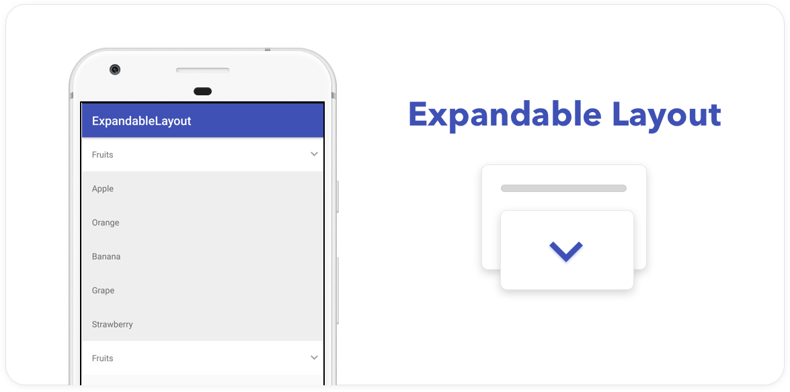

# ExpandableLayout
[](https://github.com/iammert/ExpandableLayout/actions/workflows/android.yml)
[](https://jitpack.io/#iammert/ExpandableLayout)

Expandable LinearLayout


# Setup
## Dependency
settings.gradle
```groovy
dependencyResolutionManagement {
    repositories {
        google()
        mavenCentral()
        maven { url 'https://jitpack.io' }
    }
}
```

Module build.gradle
```groovy
dependencies {
    implementation 'com.github.iammert:ExpandableLayout:2.0.0'
}
```
Requires minSdk 21.

## Layout
```xml
<iammert.com.expandablelib.ExpandableLayout
    android:id="@+id/el"
    android:layout_width="match_parent"
    android:layout_height="wrap_content"
    app:parentLayout="@layout/layout_parent"
    app:childLayout="@layout/layout_child"
    app:singleExpansion="false"
    app:animateExpansion="true"
    app:toggleOnParentClick="true"/>
```

| Attribute | Description |
| --- | --- |
| `parentLayout` | Layout of a parent row (required) |
| `childLayout` | Layout of a child row (required) |
| `singleExpansion` | Collapse the other sections when one is expanded |
| `animateExpansion` | Animate rows on expand/collapse |
| `toggleOnParentClick` | Expand/collapse when the parent row is tapped, `true` by default |

All of them have setters, e.g. `setParentLayout()` when the layout is created from code.
Give the layout an id so the expanded sections are restored after rotation.

## Set renderer
```java
expandableLayout.setRenderer(new ExpandableLayout.Renderer<FruitCategory, Fruit>() {
    @Override
    public void renderParent(View view, FruitCategory model, boolean isExpanded, int parentPosition) {
        ((TextView) view.findViewById(R.id.tvParent)).setText(model.name);
        view.findViewById(R.id.arrow).setRotation(isExpanded ? 180 : 0);
    }

    @Override
    public void renderChild(View view, Fruit model, int parentPosition, int childPosition) {
        ((TextView) view.findViewById(R.id.tvChild)).setText(model.name);
    }
});
```
`renderParent()` is called again whenever the section expands or collapses.

## Set listeners
```java
expandableLayout.setExpandListener((ExpandCollapseListener.ExpandListener<FruitCategory>)
        (parentIndex, parent, view) -> { /* section expanded */ });

expandableLayout.setCollapseListener((ExpandCollapseListener.CollapseListener<FruitCategory>)
        (parentIndex, parent, view) -> { /* section collapsed */ });

expandableLayout.setOnChildClickListener((OnChildClickListener<FruitCategory, Fruit>)
        (parentIndex, parent, childIndex, child, view) -> { /* child clicked */ });
```

## Add sections or children
```java
FruitCategory fruits = new FruitCategory("Fruits");
Section<FruitCategory, Fruit> section =
        new Section<>(fruits, Arrays.asList(new Fruit("Apple"), new Fruit("Orange")), true);

expandableLayout.addSection(section);
expandableLayout.addSections(otherSections);
expandableLayout.addChild(fruits, new Fruit("Grape"));
expandableLayout.addChildren(fruits, Arrays.asList(new Fruit("Cherry"), new Fruit("Plum")));
```

## Remove or update
```java
expandableLayout.removeChild(fruits, grape);
expandableLayout.removeSection(0); // or removeSection(fruits)
expandableLayout.removeAllSections();

expandableLayout.notifyParentChanged(0);
expandableLayout.notifyChildChanged(0, 1);
expandableLayout.notifyDataSetChanged(); // after changing sections directly
```

## Expand and collapse from code
```java
expandableLayout.expand(0);          // or expand(fruits)
expandableLayout.collapse(fruits);
expandableLayout.toggle(1);
expandableLayout.expandAll();
expandableLayout.collapseAll();
boolean expanded = expandableLayout.isExpanded(0);
```

## Filter parents and children
Filters stay active for sections and children added later and can be combined.
```java
expandableLayout.filterParent(obj -> ((FruitCategory) obj).name.startsWith("F"));
expandableLayout.filterChildren(obj -> ((Fruit) obj).name.toLowerCase().contains(query));
expandableLayout.clearFilter();
```

License
--------


    Copyright 2017 Mert Şimşek.

    Licensed under the Apache License, Version 2.0 (the "License");
    you may not use this file except in compliance with the License.
    You may obtain a copy of the License at

       http://www.apache.org/licenses/LICENSE-2.0

    Unless required by applicable law or agreed to in writing, software
    distributed under the License is distributed on an "AS IS" BASIS,
    WITHOUT WARRANTIES OR CONDITIONS OF ANY KIND, either express or implied.
    See the License for the specific language governing permissions and
    limitations under the License.
